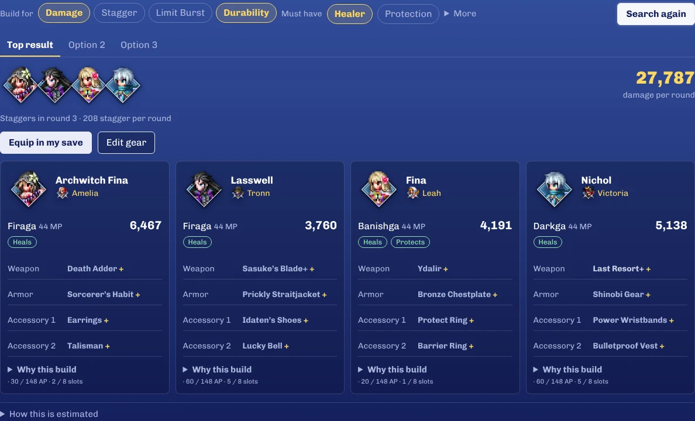

# Resonance Battle Companion

**The best party for your next boss in FINAL FANTASY RESONANCE, equipped in one click.**
**https://dylanelo.github.io/ffr-battle-companion/**

1. **Load your save.** It's in `%LOCALAPPDATA%\FFRS\Steam`, inside the numbered folder.
2. **Pick a boss.** The page opens on your next one.
3. **Equip in my save**, then swap the downloaded file into your save folder.

Your save is read in your browser and never uploaded. Without a save you can still look up every boss and Resonance.

Fan-made, not affiliated with Square Enix. Something wrong? [Open an issue](https://github.com/DylanElo/ffr-battle-companion/issues/new).

How the estimates work

Best party tries the parties of four you can field, with your Resonances, gear and abilities, and estimates damage over a five-round boss fight. It is a fast search: it shows the strongest parties it found, not a proof of the best one.

The damage arithmetic was checked against isolated instruction blocks of the installed game executable: 1,009 attack/defense pairs, 5,000 HP cases, 5,000 stagger cases and all 9,801 level pairs from 1 to 99. Turn order, stagger, Limit Bursts, Finish attacks, HP/MP costs, luck and form states follow verified native rules; random turn order and Gamble outcomes are averaged over reproducible samples. Enemy entries are base data, so a specific fight can differ.

Evidence and limits: [model notes](docs/model-notes.md), [combat](docs/combat-verification.md), [commands](docs/command-verification.md), [initiative](docs/initiative-verification.md), [mixed commands](docs/mixed-command-verification.md), [special actions](docs/special-action-verification.md), [HP costs](docs/hp-cost-verification.md), [resource states](docs/resource-state-verification.md), [forms, Focus and reactions](docs/state-action-verification.md), [Gamble](docs/gamble-verification.md), [Finish](docs/finish-verification.md).

## Development

Static files in [`docs/`](docs), no build step: `python -m http.server -d docs`. Tests: `node --test` (Node 22+); CI runs the same command. Tests that need the local desktop importer and a real save skip without it.

- [`docs/app.js`](docs/app.js): the interface. Party (home), Bosses, Characters and Resonances.
- [`docs/optimizer-ui.js`](docs/optimizer-ui.js) and [`docs/build-details.js`](docs/build-details.js): results as the move, gear, abilities and always-on effects; each opens to the game's description and what it adds.
- [`docs/core.js`](docs/core.js): stock, reservations, recommendations and mastery rules.
- [`docs/save.js`](docs/save.js): the encrypted save format. [`docs/save-io.js`](docs/save-io.js) reads a save into a snapshot and writes plans into a copy of it, refusing a save that changed after it was loaded.
- [`docs/damage.js`](docs/damage.js), [`docs/passives.js`](docs/passives.js) and [`docs/stats.js`](docs/stats.js): native-formula damage, supported effect rules and saved-progression stat derivation.
- [`docs/battle.js`](docs/battle.js) and [`docs/search.js`](docs/search.js): legal loadouts and the shared-inventory party search, in a Web Worker. Every character gets a share of the candidate time budget before teams are ranked. The beam ranks parties on a few reproducible samples (members' own scores after its deadline), and every party shown is re-scored on all of them.
- [`docs/data/catalog.json`](docs/data/catalog.json): game tables (Resonances, skills, passives, equipment, characters, enemies), generated locally from an installed copy of the game.
- Asset links carry `?v=` cache versions. Bump a file's version in every reference when it changes; `tests/asset-versions.test.cjs` fails on unversioned or mismatched references.
- The page allows only its own scripts, styles, fonts and data (Content-Security-Policy in `index.html`). The Chivo font is bundled under the [SIL Open Font License](docs/fonts/OFL.txt).
